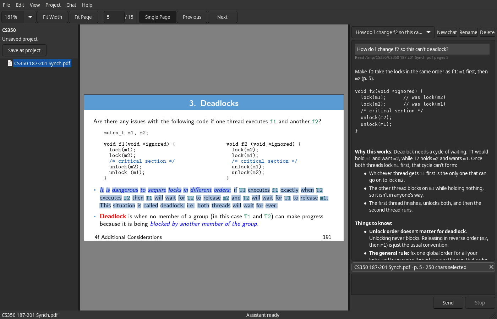

# Agentic Reader

A desktop PDF reader with a Claude chat pane that knows what you are reading. Each prompt carries the open file, the current page and your selection, so you can ask about a passage without copying it.



The app is C++ with wxWidgets and renders PDFs with Poppler. Chat runs through a Python sidecar on the Claude Agent SDK, which the app talks to over stdio.

## Features

- PDF viewing with zoom, fit width or page, continuous or single-page layout, and fullscreen presentation (F11). Slide decks open in single-page mode.
- Text selection, copy and a find bar.
- Chat pane that sends the file, page and selection with each prompt. "Ask about selection" (Ctrl+Shift+A) quotes the selection into the input.
- Projects are folders of PDFs. Each project has `CLAUDE.md` instructions, saved chats you can resume, and a remembered page per file.
- Tool use beyond Read, Glob and Grep asks for permission first.

## Build

Needs CMake 3.25+, Ninja, a C++20 compiler, [vcpkg](https://github.com/microsoft/vcpkg) and Python 3.11+. On Linux, vcpkg's ports also need the system packages listed in `.github/workflows/build.yml`. The first vcpkg build takes a while.

```
export VCPKG_ROOT=$HOME/vcpkg
cmake -B build -S . -G Ninja -DCMAKE_TOOLCHAIN_FILE=$VCPKG_ROOT/scripts/buildsystems/vcpkg.cmake
cmake --build build
```

Set up the sidecar:

```
cd sidecar
python -m venv .venv
.venv/bin/pip install -e '.[dev]'
```

## Run

The app looks for a `reader-sidecar` executable next to itself. From a source build, point it at the venv instead:

```
READER_SIDECAR_CMD=$PWD/sidecar/.venv/bin/reader-sidecar ./build/app/agentic-reader [file.pdf]
```

Open Edit > Preferences to set up Claude:

- Anthropic API key. Stored in the system keyring (libsecret, Credential Manager or Keychain).
- Model. Blank uses the SDK default.
- "Use my local Claude Code login (developer)". Skips the key and uses your `~/.claude` login. For personal use only.
- "Use my claude.ai connectors". Needs the local login.

## Projects

Open a folder with Project > Open Project (Ctrl+Shift+O). The layout is:

```
MyProject/
├─ CLAUDE.md                 project instructions (Project > Instructions)
├─ *.pdf
└─ .reader/project.json      open files, last page per file, saved chats
```

## Shortcuts

| Key | Action |
| --- | --- |
| Ctrl+O | Open file |
| Ctrl+Shift+O | Open project |
| Ctrl+F | Find |
| Ctrl+Shift+A | Ask about selection |
| Ctrl+L | Focus chat input |
| Ctrl+N | New chat |
| Ctrl+Tab, Ctrl+Shift+Tab | Next and previous chat |
| Ctrl+Shift+L | Switch continuous and single-page layout |
| F11 | Fullscreen |

## Layout

| Path | Contents |
| --- | --- |
| `app/src` | wx app: PDF view, chat pane, projects, settings |
| `sidecar/` | Python sidecar. Protocol in `sidecar/PROTOCOL.md` |
| `tests/` | doctest suites, test PDFs, acceptance steps |
| `scripts/` | headless screenshot and clean-environment helpers |
| `tasks/` | milestone task files and agent workflow docs |
